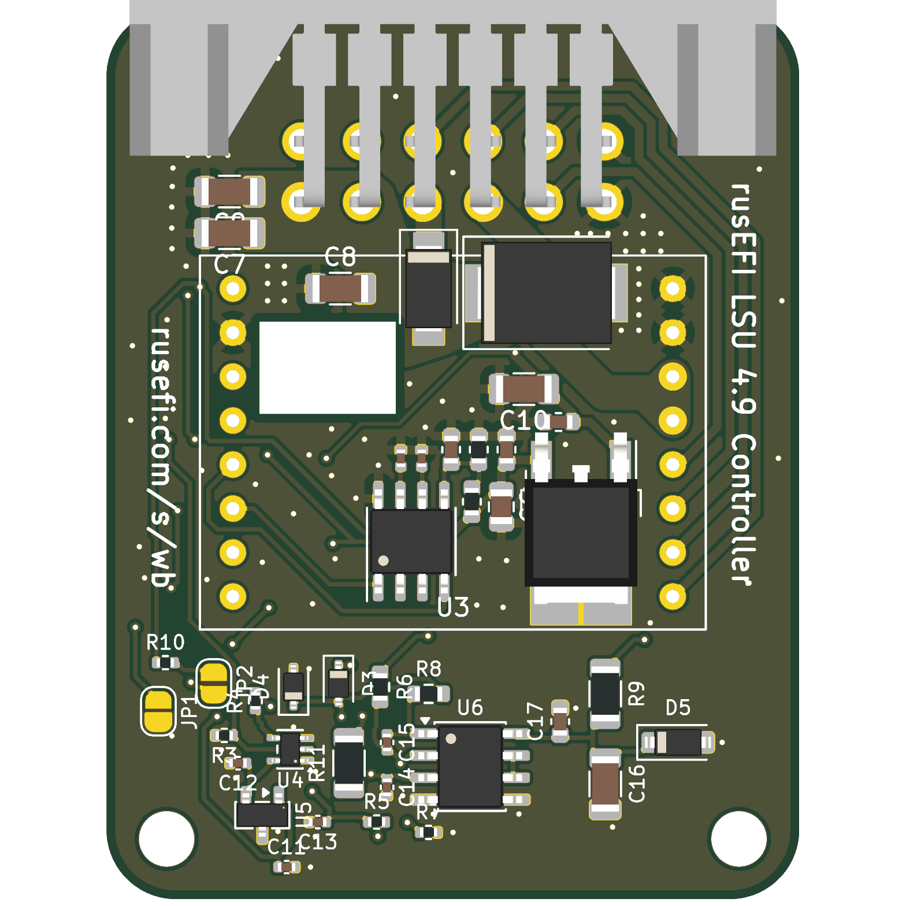

# wideband-work: rusEFI wideband controller with a 0-5 V analog output

> [!NOTE]
> This is a fork of [mck1117/wideband](https://github.com/mck1117/wideband) (MIT) on branch `analog-out`. `master` is
> upstream, untouched. Nothing here has been built or tested on hardware yet. As of 2026-10-24 the carrier board (r41)
> is routed and checked, with JLC fab files exported and verified part by part; an independent audit round and the
> order are still to come.

This repository is three things at once.

**1. A wideband O2 controller.** It is upstream's open STM32 controller for a Bosch LSU 4.9 sensor plus a 0-5 V analog
output on the carrier board. With that output it works with any ECU or logger that reads a voltage, not only rusEFI
over CAN: Speeduino, a Honda K20 on Hondata FlashPro (datalogging), a gauge for carburettor tuning. The output is
10-20 AFR = 0-5 V, 0 V while the sensor isn't ready, buffered from a 3.000 V reference and filtered. The op-amp takes
its feedback at the output pin, so the receiver's input (pull-up or pull-down) doesn't shift the reading, and it stays
stable into cable capacitance; both were checked against TI's op-amp model. The firmware also gains an independent
watchdog on the heater loop, and fixes for three bugs found by host and emulator tests: two inherited from upstream
(bootloader write bounds, a Cortex-M0 fault handler that locked up) and one of ours.

**2. An AI-designed hardware project.** Claude (Anthropic) did the design work from code, with the owner directing it:
- the requirements, parts research against the JLC/LCSC catalogue, and the firmware change
- the schematic (`work/gen/gen_carrier_sch.py`) and the PCB (`work/gen/gen_carrier_pcb.py`, with placement, routing and
  a negotiated router for the dense analog area), all generated
- SPICE checks of the analog stage
- the JLC fab files, with each part's rotation, origin and pin names measured from its EasyEDA footprint (that check
  caught the reverse-polarity diode, which would otherwise have been placed backwards)
- every check that gates an order

Every claim carries an evidence tag (DOCUMENTED / REPORTED / INFERRED / UNKNOWN), and the mistakes it caught are in
`work/LESSONS.md`.

**3. A worked example of a documented workflow.** The project follows the
[`pcb-design` skill](https://github.com/flyboy-byte/scripts-docs-dotfiles/tree/master/skills/pcb-design):
- a stage-gated `STATE.md`
- checks that run together (`work/checks/run_all.py`)
- a money gate (`release.py`) that refuses to copy fab files unless everything passes and an audit is clear
- a drift check for hand edits in KiCad
- attempt logs with results
- a `HANDOFF.md`, so a new session or another model can pick the work up cold

`AGENTS.md` is written for any model; Codex audits go through `work/checks/audit_pack.py`, and the two models take
turns (audit, verify, fix) as `AGENTS.md` describes. Rounds so far are in `work/AUDIT.md`.

## Where to look

| Path | What |
| --- | --- |
| `work/STATE.md` | Current stage, decisions, check results, what's open |
| `work/RELEASE_ASSESSMENT.md` | Plain-language status: what is checked, how independently, the open caveats |
| `work/HANDOFF.md` | Dense hand-off for the next session: run history, last raw output, next steps |
| `work/docs/analog-out.md`, `carrier.md`, `firmware.md` | The design, with sources |
| `work/gen/` | Schematic and PCB generators, the routing finisher |
| `work/checks/` | The checks (`run_all.py`): DRC against upstream's baseline, via-in-pad, layout review, JLC rotation, fab files, firmware tests, drift, release gate |
| `work/gen/export_fab.py` | Gerbers, BOM and CPL for JLC (into `work/out/`, gitignored; only `release.py` puts files in `fab/`) |
| `work/sim/` | ngspice decks: filter, op-amp stability, accuracy into different receiver inputs |
| `firmware/` (branch `analog-out`) | Analog output on PB1 / TIM3_CH4, bench test mode, trim, watchdog |
| `test/` | Upstream's unit tests plus ours (`test/aux_out/` for the analog output) |
| `AGENTS.md`, `CLAUDE.md` | How an AI (any model) works in this repo |

---

*Upstream's README follows.*

 

# rusEFI Wideband Controller

[User Documentation](https://rusefi.com/s/wb)

[Forum Thread](https://rusefi.com/forum/viewtopic.php?f=4&t=1856)

## Building Firmware

The `firmware/boards` directory contains configuration for each board this firmware supports.

For the standalone board and the module built in to rusEFI Hellen boards, `f0_module` is the correct target.  Use the `build_wideband.sh` script to build and package the wideband firmware: both a bin including the bootloader, and a header file consumed by rusEFI that contains no bootloader, to be uploaded over CAN (via the aforementioned bootloader).
